# CS464 Assignment 01 · Mohsin Raza Ojla · BSSE23040

## Game 1 · Subway Surfers

- **Store link:** [Google Play](https://play.google.com/store/apps/details?id=com.kiloo.subwaysurf)
- **Genre:** Endless runner
- **I played:** more than 30 minutes over a few sessions, and I got well past the tutorial. I ran many times, collected coins and tried the power-ups.
- **Video (optional):** none

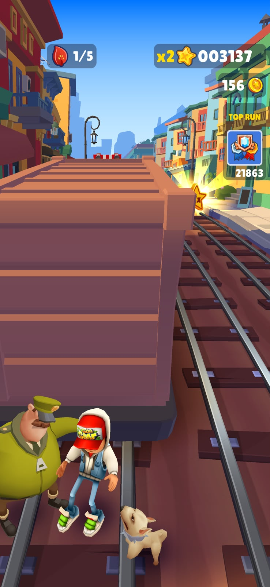
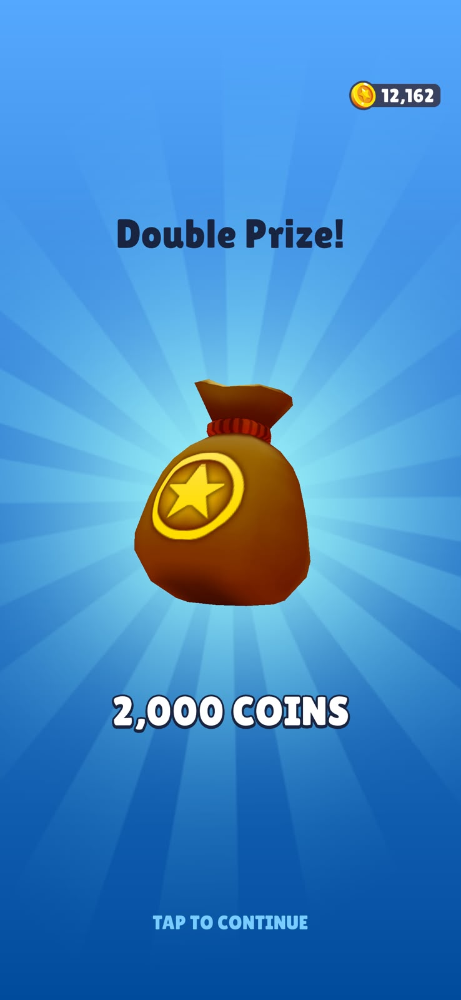
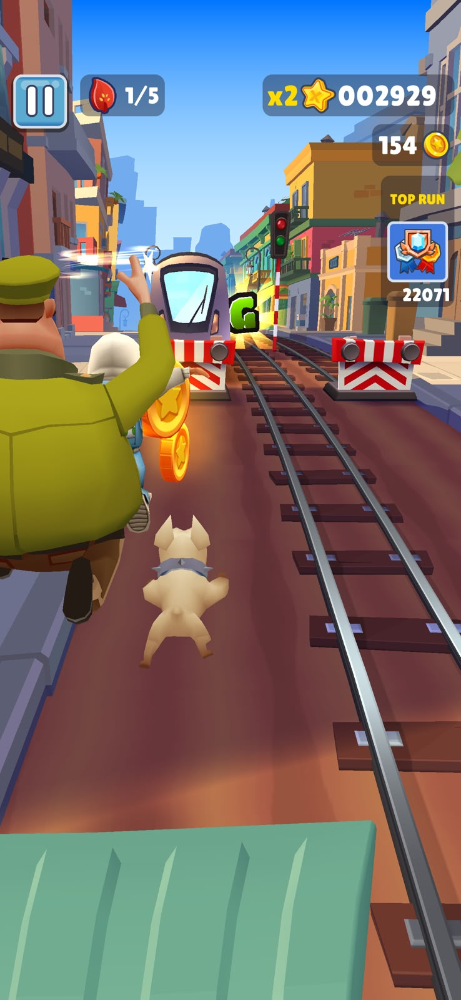
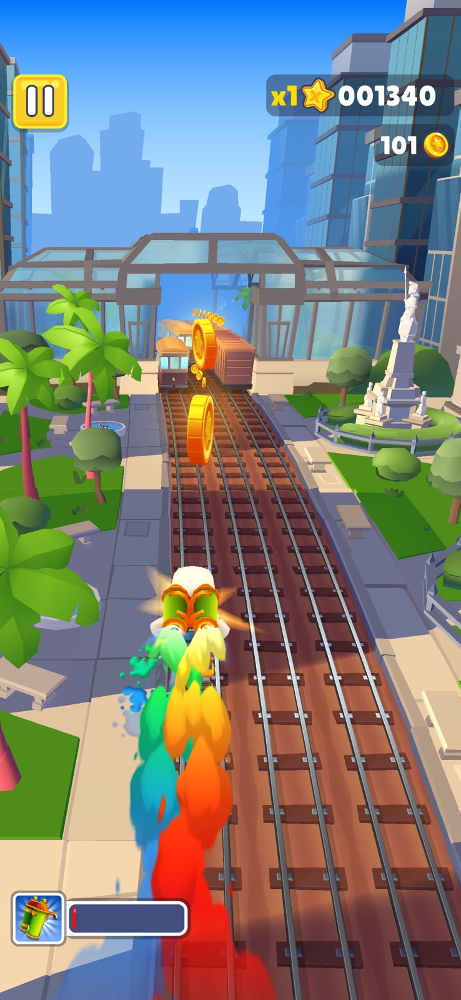

1. [M2, M4, M6, M7] · I hit a train and now the guard and his dog are chasing me. The score, coins and top run box are at the top right, and there is an event counter at the top left.
2. [M3] · A reward screen gives me a bag of coins.
3. [M1, M2] · Running down the track with the guard right behind me and a train coming in my lane.
4. [M5, M3] · Using the jetpack. I'm flying over the track and picking up coins from above.

| # | Mechanic | Dynamic | Aesthetic | Bartle type |
|---|---|---|---|---|
| M1 | You swipe left or right to change lane, up to jump and down to roll. | Players look ahead and change lane early to dodge trains and barriers. | Challenge: you need quick reactions all the time. | Achiever (acting × world): you get better at the controls so you can run further. |
| M2 | If you crash once you stumble and the guard catches up. If you crash again soon after, the run ends. | After the first crash players play very carefully until the guard falls back. | Challenge: one mistake is forgiven but the next one ends the run, so it feels tense. | Achiever (acting × world): the game's own obstacles are what you play against. |
| M3 | You collect coins on the track and spend them in the shop on characters, boards and upgrades. | Players go for coins, even in risky spots, and play one more run to afford the next thing. | Expression: coins let you choose how your character looks. | Achiever (acting × world): there is always something to save up for. |
| M4 | Your score goes up with the distance you run, and it is multiplied by a number that you raise by finishing missions. | Players do the missions that raise the multiplier first so their next run scores more. | Challenge: you beat your old score by playing better, not only longer. | Achiever (acting × world): the number keeps growing. |
| M5 | Power-ups like the jetpack lift you above the track for a short time. | Players use them to grab lines of coins in the air and skip hard parts of the track. | Sensation: flying over the city feels good. | Explorer (interacting × world): you find out what each power-up does and when it helps. |
| M6 | A "top run" box shows a score from the leaderboard that you try to pass. | Players push harder when they get close to that score. | Challenge: there is a clear score to beat. | Achiever (acting × world): you are trying to beat a number. |
| M7 | Event items that you pick up during runs fill a counter and give a reward when it is full. | Players change their route to pick up the items and come back on other days to finish. | Discovery: you want to find out what the event reward is. | Explorer (interacting × world): you go and look for what the event offers. |

**Aesthetic profile:** Challenge is the main one (M1, M2, M4, M6) because every few seconds you can lose the run. Expression (M3) and Sensation (M5) come next. They are the reasons I kept playing: new looks for the character and the jetpack.

**Player types**
- Primary: Achiever (acting × world), because I'm always pushing for a better result: running further, getting more coins and a higher score (M1, M3, M4). That is acting on the game. It is the world axis because what I play against is the game itself, with its obstacles and numbers (M2), not other players.
- Secondary: Explorer (interacting × world), because power-ups and event items (M5, M7) are things I try out to see how they work. That is interacting with the game, and again it is the world axis because it is all part of the game system.

## Game 2 · PUBG Mobile (Team Deathmatch)

- **Store link:** [Google Play](https://play.google.com/store/apps/details?id=com.tencent.ig)
- **Genre:** Battle royale shooter. I played the Team Deathmatch mode.
- **I played:** several Team Deathmatch matches with a squad, more than 30 minutes in total.
- **Video (optional):** [Gameplay video on Google Drive](https://drive.google.com/file/d/1y0W_UMxk9EDx2N6BEBmI4L2l0xynUpi4/view?usp=sharing)

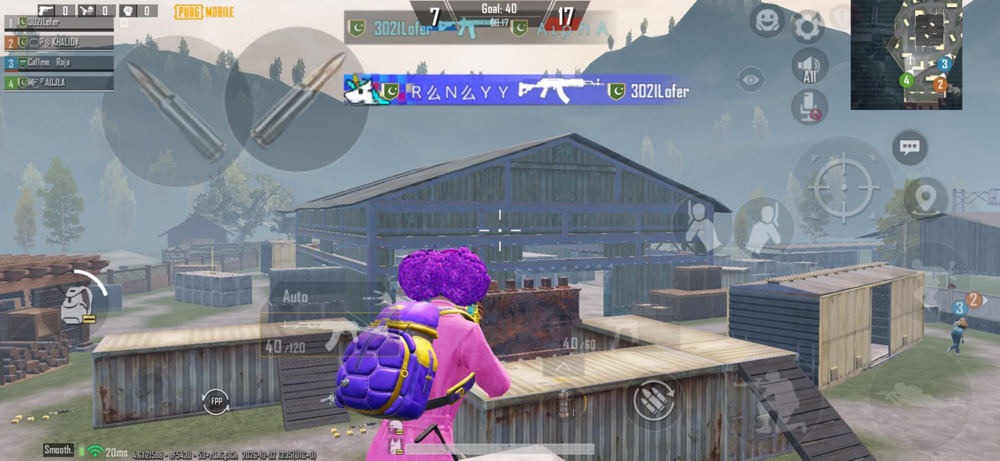
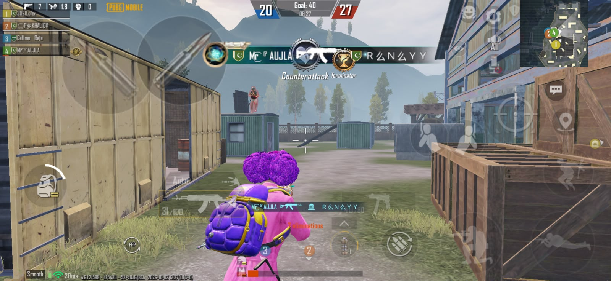
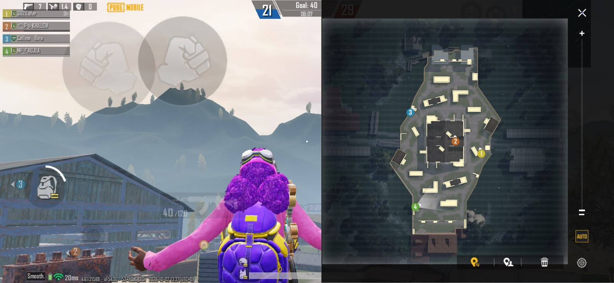

1. [M1, M3, M4, M5, M7] · A Team Deathmatch match. The score and timer are at the top, my gun is at the bottom left, the control buttons are on the right and the minimap is at the top right. My teammates are listed on the left.
2. [M2, M6] · A kill and a medal popup on screen while we fight around the containers.
3. [M5, M7] · The big map is open and my squad shows up as numbered markers.

| # | Mechanic | Dynamic | Aesthetic | Bartle type |
|---|---|---|---|---|
| M1 | A Team Deathmatch match ends when one team reaches the kill target, or when the time runs out. | Teams fight over the middle instead of hiding, and the losing team takes bigger risks near the end. | Challenge: there is a clear goal and a time limit. | Killer (acting × players): you win by beating the other team. |
| M2 | When you die you respawn and get back into the fight. | Players push again quickly and take more risks because dying costs very little. | Challenge: you can try bolder moves without a big punishment. | Killer (acting × players): you keep fighting the same enemies. |
| M3 | Guns have limited ammo in the magazine and you have to reload. | Players hide behind cover to reload and try not to waste shots. | Challenge: managing your ammo can decide a fight. | Achiever (acting × world): you get better at using the gun properly. |
| M4 | On the touch screen you move with a stick and use buttons to aim, shoot, jump, crouch and lie down. | Players climb on boxes and roofs to get height, and crouch or go prone behind cover. | Sensation: moving and shooting on the screen feels like handling a weapon. | Explorer (interacting × world): you learn what each move can do on the map. |
| M5 | You play in a squad, so you can see your teammates, chat with them and mark places on the map. | Teammates call out enemies and attack the same spot together. | Fellowship: you win together as a team. | Socializer (interacting × players): you play with other people. |
| M6 | The game shows medals and banners for things like kill streaks and revenge kills. | Players hunt the person who killed them to get a revenge medal and try to keep their streak going. | Challenge: a medal shows that you did something hard. | Killer (acting × players): the reward is for beating a specific player. |
| M7 | A minimap and a full map show where your teammates are. | Players check the map before picking a route and meet up with their squad. | Discovery: reading the map shows you where the fight is. | Explorer (interacting × world): you work out how the map is laid out. |

**Aesthetic profile:** Challenge is the biggest one (M1, M2, M3, M6) because every fight can be lost and the match is always close. Fellowship (M5) and Discovery (M7) come next: you plan with your squad and read the map before you push.

**Player types**
- Primary: Killer (acting × players), because I'm doing something to the other side: shooting and winning fights (M1, M2). That is acting. It is the players axis because what I play against is the other team, not the game's system. The medals (M6) are also about beating a person.
- Secondary: Socializer (interacting × players), because I play together with my squad, using chat, pings and the team list (M5). That is interacting, and it is the players axis because the fun comes from the other people. I also use the map (M7) to meet up with them.

## Level blockouts

All five levels are in `Assets/Scenes/` as `Level01.unity` to `Level05.unity`. Each one has a capsule player (2 m tall, 1 m wide) at the spawn, a green goal, and a route of at least 30 m through two or more spaces and past a challenge. They are built from one set of prefabs in `Assets/Prefabs/`, with flat colours only.

| Level | Screenshot | Its idea | Wayfinding tool |
|---|---|---|---|
| Level01 | 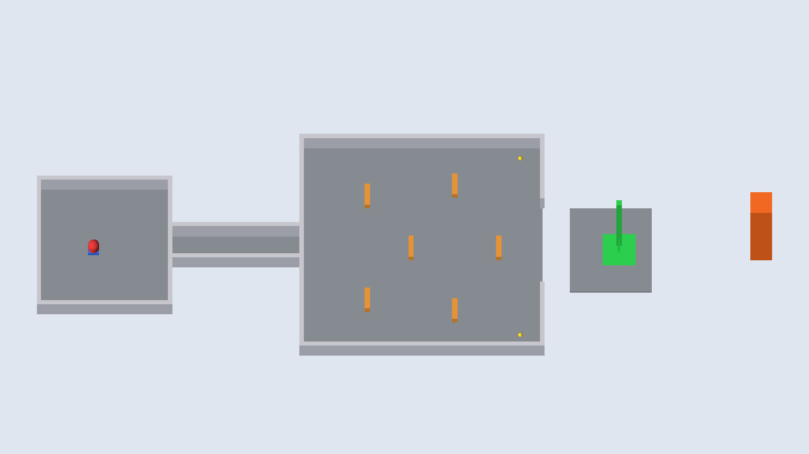 | A simple first level: a spawn room, a corridor, a yard with low cover, and then one jump across a gap to the goal. | Landmark: a tall orange tower behind the goal that you can see from the start. |
| Level02 | 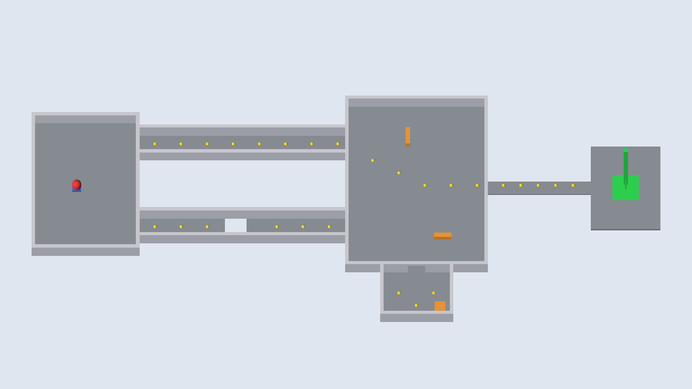 | The route splits. The left corridor is safe, the right one is shorter but has a gap. Both end in a hall with a side room, then a narrow bridge to the goal. | Breadcrumbs: a trail of coins shows the way. |
| Level03 | 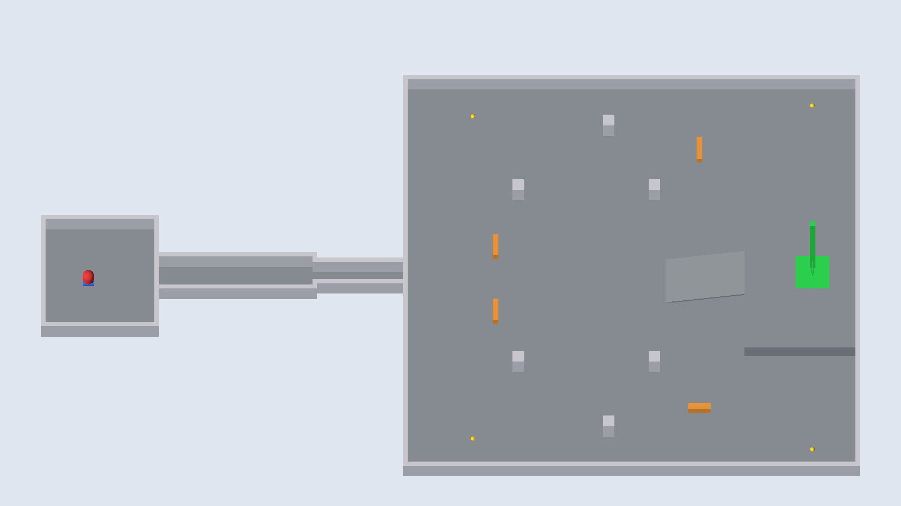 | A narrow corridor gets even narrower at a small door, then opens into a big hall. The goal is on a platform up a ramp. | Pinch and release: the tight door opens into a big space and you can see the goal. |
| Level04 | 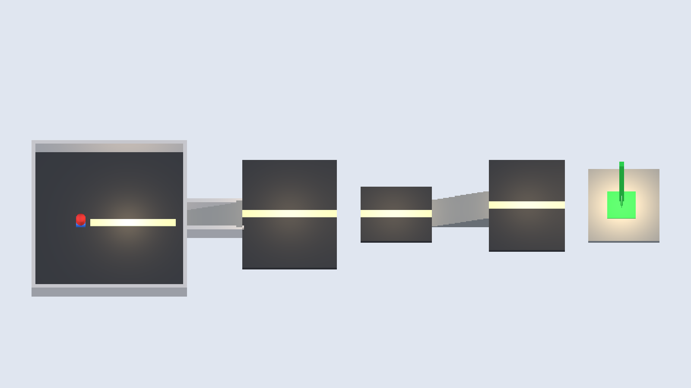 | A climb with stairs and two jumps across gaps between platforms. The goal is at the top. | Light and contrast: the floor is dark, each platform has a bright strip and a warm light, and the goal is the brightest. |
| Level05 | 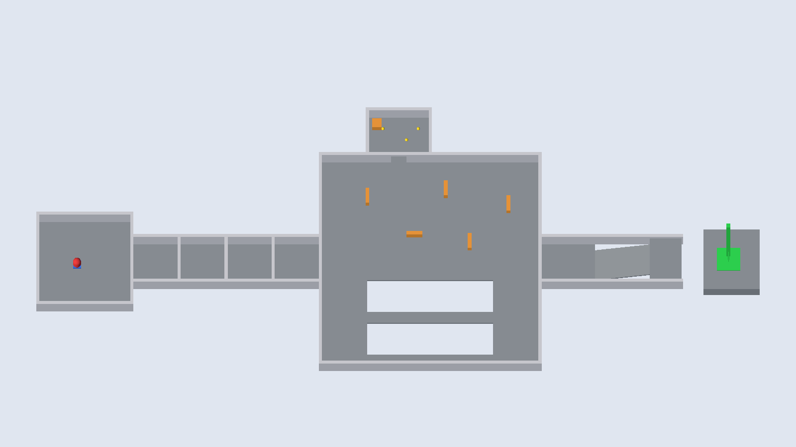 | Everything together: a hall of doors, a courtyard where you pick the cover side or a narrow bridge, then a ramp and a last jump to the goal. | Framing: three doorways in a row point to the way forward. |

The sizes follow Lecture 03: doorways at least 1.5 m wide and 2.5 m tall, walls 3 m, steps 0.3 m and jumps of 3 m or less. `Assets/Editor/LevelBuilder.cs` can rebuild the levels from the menu (CS464 > Build Kit + Levels).

---
Note: the commit dates in this repository were adjusted as part of the Git practice exercise, as allowed by the instructor.
